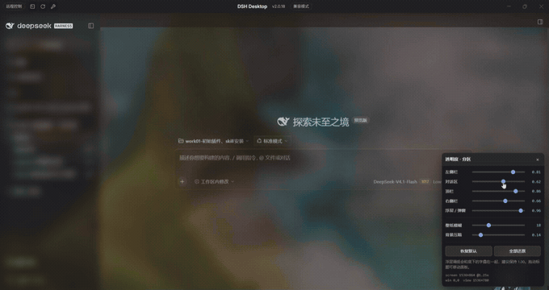
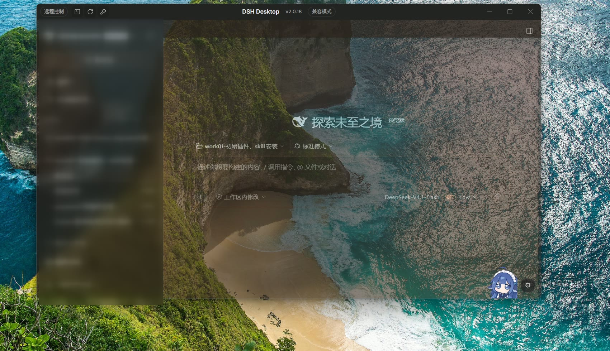
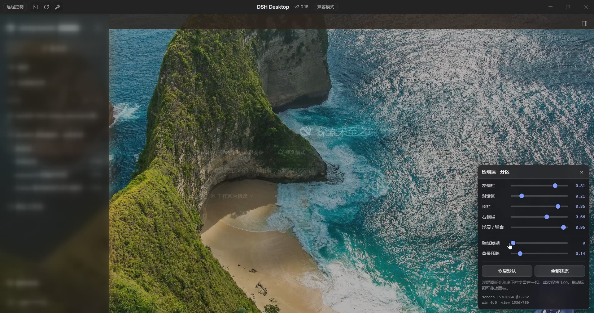
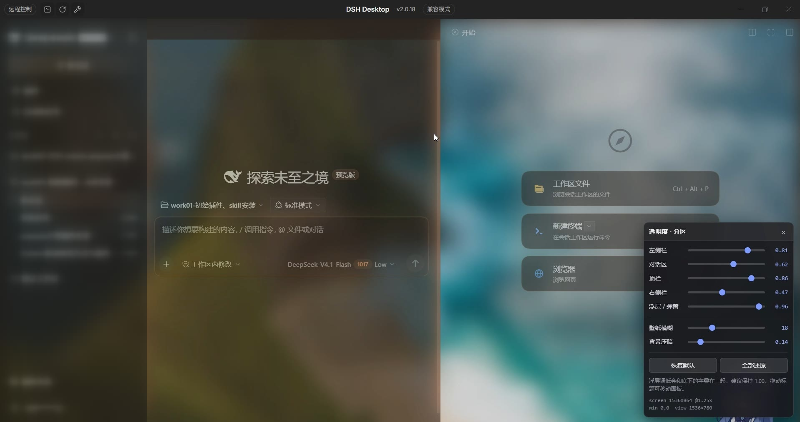
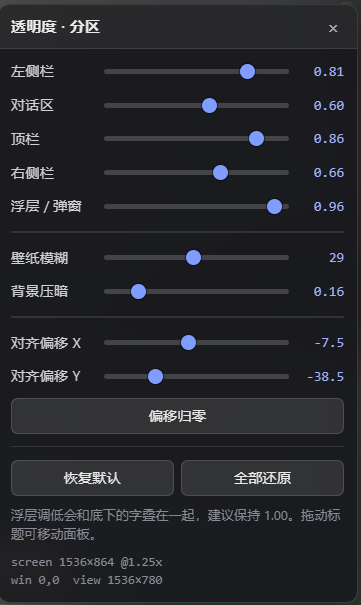

# dsh-desktop-transparency

**让 DSH Desktop 的窗口看起来真的透到桌面**——按屏幕坐标钉住系统壁纸，再按区域调半透明。

Per-region translucency for DeepSeek Harness Desktop, backed by a screen-aligned system wallpaper.

> 状态：可用，但**分区选择器绑定 DSH 版本**（见[兼容性](#兼容性)）。失效时插件会自我提示，不会静默坏掉。



**[▶ 完整演示（24 秒 · 无声 · 757KB）](docs/video/demo.mp4)**

> 演示与截图中的左侧栏已做磨砂处理，用于遮盖个人会话名。

---

## 效果

### 窗口不是贴了一张壁纸，而是和屏幕对齐



这是本插件最核心的证据。窗口**没有最大化**，浮在桌面之上：

- 左边缘外侧的礁石 → 内侧同一块礁石继续
- 底部外侧的沙滩与浪花 → 内侧纹理连续
- 右边缘外侧的岩壁 → 内侧纹路接上

窗口拖到哪、缩放到多大，壁纸都**相对屏幕不动**，只露出更多或更少。
所以看起来像窗口真的透了，而实际上是把系统壁纸钉在了界面底层。

### 照片壁纸透过界面



五个分区各自独立调节——图中「对话区」被压到 **0.21**，照片几乎完全透出来，
而左栏（0.81）与浮层（0.96）依然保持可读。

### 分区独立控制



右侧栏展开时同样独立生效：图中右侧栏 **0.47**、对话区 **0.62**、壁纸模糊 **18px**。
右侧栏比对话区更透明，是因为它是辅助面板，不需要那么高的对比度。

### 控制面板



十个控件：五个分区透明度、壁纸模糊、背景压暗、对齐偏移 X / Y，外加偏移归零与整体还原。

---

## 为什么需要它

DSH Desktop 底层是 Electron。主进程 `window-material.ts` 里：

```js
function parseWindowsWindowMaterial(value) {
  if (value === "off") return value;
  if (value === "acrylic" || value === "mica") return "off";  // 静默降级
  throw new Error('dsh-desktop.windowsMaterial must be "off"');
}
```

**Windows 上窗口材质只允许 `off`**，传 `transparent` 直接抛错。也就是说
"真·窗口穿透"在当前桌面端被主进程关死了，改 CSS 也绕不过去。

本插件换了个思路：**读系统壁纸 → 按屏幕坐标钉在界面最底层 → 把界面调半透明**。
视觉效果接近真穿透，且不会让桌面端崩溃。

---

## 对齐原理

不按"窗口"铺图，而是把图钉死在**屏幕坐标系**上：

```
元素尺寸        = 屏幕逻辑尺寸 (SW × SH)
background-size = SW px × SH px        （与 Windows「填充」一致）
元素位移        = (-window.screenX, -window.screenY)
```

窗口向左挪 10px，图就向右补偿 10px——**壁纸相对屏幕永远不动**。
窗口缩放时图的缩放比例不变，只是露出更多或更少。

**图像原点永远落在屏幕 (0,0)**，这是对齐成立的充要条件（测试里就断言这一条）。

---

## 安装

### 从 GitHub（当前可用）

```sh
dsh plugin --profile desktop add github:biotechdrli-byte/dsh-desktop-transparency
```

装完**完全退出 DSH Desktop 再重新打开**（刷新页面不够）。

### npm

<!-- npm 发布后启用以下说明，并把上面一节降级为备选 -->
<!--
```sh
dsh plugin --profile desktop add dsh-desktop-transparency
```
-->

即将发布。

### 卸载

```sh
dsh plugin --profile desktop remove dsh-desktop-transparency
```

---

## 分区透明度

`opacity` 会沿 DOM 树向下相乘，所以"整窗统一降透明度"会让弹窗、菜单一起变淡，
和底下的文字叠在一起。本插件对**互为兄弟**的五个区域各设各的 opacity：

| 分区 | 默认 |
| --- | --- |
| 左侧栏 | 0.81 |
| 对话区 | 0.60 |
| 顶栏 | 0.86 |
| 右侧栏 | 0.66 |
| 浮层 / 弹窗 | 0.96 |

壁纸模糊默认 29px，背景压暗默认 0.18。

### 结构让位

中区根节点原本用一块底色铺满整个中区，顶栏和对话区都透它——不拆开这两块，
它们永远只能一起变。所以插件会让根节点交出底色，由 header 与 body 各自承担：

```css
.MnhYfG_frame{background:transparent !important}
._727C8a_root{background:transparent !important}
._727C8a_body{background:var(--dsw-alias-bg-base,#151517) !important}
header._727C8a_header{background:var(--dsw-alias-bg-base,#151517) !important}
```

侧栏不动底色（它比中区浅，覆盖会破坏层次）。`opacity` 为 1 时视觉与原样一致。

---

## 控制面板

右下角浮动面板，拖动标题可移动，`Ctrl+Alt+H` 收起/展开。
收起后右下角保留一个 **⚙ 圆点**，点它可重新打开。

| 控件 | 范围 | 默认 |
| --- | --- | --- |
| 五个分区透明度 | 0.05 ~ 1.00 | 见上表 |
| 壁纸模糊 | 0 ~ 60 px | 29 |
| 背景压暗 | 0 ~ 1.00 | 0.18 |
| 对齐偏移 X / Y | -80 ~ +80 px | 0 |

所有调节自动存 `localStorage`（键 `dsh-dtp-state`），重启后保留。

### 快捷键

| 快捷键 | 作用 |
| --- | --- |
| `Ctrl+Alt+H` | 显示 / 隐藏面板 |
| `Ctrl+Alt+←→↑↓` | 对齐微调 1px（加 `Shift` 为 10px） |
| `Ctrl+Alt+D` | 导出界面结构快照 |

---

## 对齐校准

**大多数机器第一次用都需要校准 1~2px。** 判断标准：把窗口拖成非最大化，
盯**窗口边框**——框内的壁纸应该和框外的桌面壁纸**无缝接上**。

做法：拖「对齐偏移 X / Y」滑块，或用 `Ctrl+Alt+方向键`（步进 1px，更精细）。

参考值（作者机器：Windows、125% 缩放、DSH Desktop 2.0.18）：

```
X = -7.5    Y = -38.5
```

两者都指向**窗口外框内缩**：X 约等于无边框窗口的隐形 resize 边框，
Y 约等于 36px 标题栏 + 边框。**这组值不代表你的机器也一样**，请自行校准。

> 如果最大化与还原状态下偏移量不同，说明是 Windows 最大化把边框推到屏幕外所致，
> 目前需要两套值切换（尚未实现，欢迎 PR）。

---

## 隐私

本插件会：

- **读取** Windows 当前桌面壁纸文件
  （`%APPDATA%\Microsoft\Windows\Themes\TranscodedWallpaper`，取不到再退回注册表原图路径）
- 通过**本机回环** HTTP 路由把它交给页面自己显示
- 把界面结构快照写到 `~/.dsh/dsh-dtp-dom.json`（仅在按 `Ctrl+Alt+D` 或启动 6 秒后自动触发）

本插件**不会**：

- 发起任何外部网络请求（壁纸不出本机）
- 上传、遥测、统计
- 读写你的会话内容

自定义路由都过了宿主提供的**信任栅栏**：未授权的请求返回 **401**，不会吐出壁纸。

---

## 兼容性

| 项 | 值 |
| --- | --- |
| 平台 | Windows（macOS 原生支持窗口透明，不需要本插件） |
| DSH Desktop | 实测 `2.0.18` / 内核 `0.2.1-rc.2` |
| 桌面壳形态 | `compatibility`（无 `.dshDesktop*` 外壳） |
| Node | ≥ 20 |
| 运行时依赖 | 零 |

⚠️ **分区选择器是 DSH 编译产物的哈希类名，升级 DSH 后可能失效。**

失效时不会静默坏掉：面板上对应分区的名字后面会显示 **⚠**。处理方式：

1. 按 `Ctrl+Alt+D` 导出 `~/.dsh/dsh-dtp-dom.json`
2. 在快照里找到该区域的 `tag` / `class` / 尺寸
3. 修改 `lib/client.js` 顶部 `REGIONS` 数组里的 `sel`
4. 重启

---

## 故障排查

**装上没反应 / 背景没出现**

```
curl -i http://127.0.0.1:<端口>/dsh-bg/info
```

- **401** → 路由已注册，插件是活的（401 是信任栅栏，正常）
- **404** → 插件没加载，检查是否在 `dsh.profile.bundles` 里、以及是否真的重启了

端口见 `%USERPROFILE%\.dsh\profiles\desktop\.dsh-desktop-runtime.json`。

**分区滑块没反应** → 看面板上有没有 ⚠，按上面的流程改选择器。

**壁纸换了自己没跟上** → 插件每 5 秒轮询壁纸文件 mtime，正常情况下 5 秒内会跟上。

---

## 开发

```sh
npm test
```

两套测试：

- `test/client.test.mjs` —— 最小 DOM stub 跑真实客户端代码，验证**屏幕对齐数学**、
  分区隔离、自激循环回归、面板收起/找回
- `test/host.test.mjs` —— 假 `webServer` 跑真实 Host 代码，验证壁纸发现、MIME 识别、
  路由响应、信任栅栏、无 `webServer` 时安全降级

### 结构

```
lib/index.js     Host：发现系统壁纸 + 路由（/dsh-bg/info、/dsh-bg/wallpaper）+ 快照落盘
lib/client.js    浏览器：屏幕坐标对齐层、分区透明度、控制面板
cordis.patch.yml bundle 声明
test/            两套测试
```

### 性能

| 环节 | 做法 | 开销 |
| --- | --- | --- |
| 窗口移动/缩放 | 只改 `transform: translate3d` | 合成器处理，不重绘 |
| 模糊 | `filter: blur()` 作用于静止图层 | 结果被缓存，非每帧重算 |
| 位置检测 | 静止时降到 4Hz，一动切回 rAF | 空转近似为零 |

刻意**没有**用 `backdrop-filter` 做背景模糊——它会每帧采样身后内容，全屏开销极大。
面板自身用了，但面积小可忽略。

---

## 已知限制

- 仅 Windows
- 多显示器未处理（按单屏主屏计算）
- 最大化/还原若偏移不同，需手动切换（未实现）
- 与其它主题插件的背景层可能冲突，**同一时间只应启用一个**

---

## License

[MIT](LICENSE)
